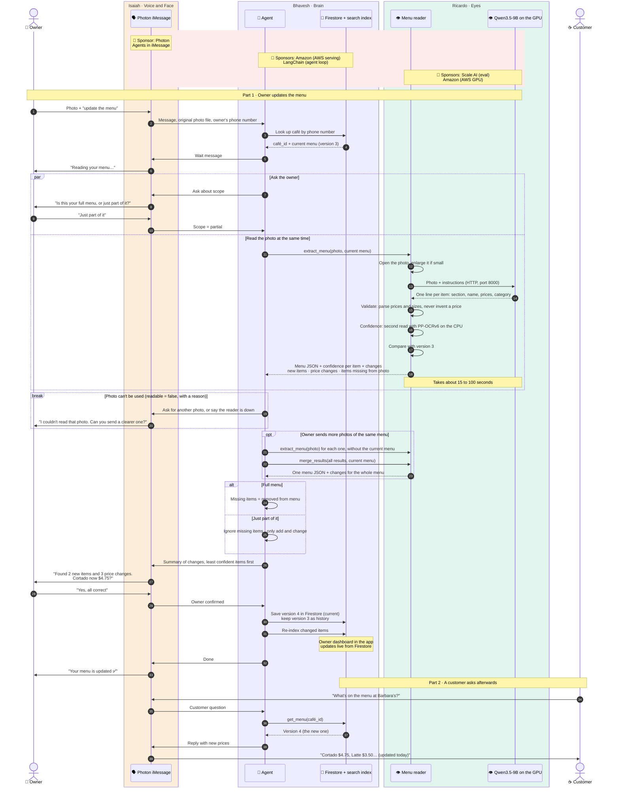

# How a menu update flows through JOLO

I updated the menu reader's steps (my lane) to show what I actually built. The
agent, database and iMessage steps are our original plan. I only added two
things there, the wait message and the unreadable-photo branch, because the way
my reader behaves makes them necessary.

## What changed from the original chart

| Step | Original | Now | Why |
| --- | --- | --- | --- |
| Inside the menu reader | "Crop, read, validate" | Open and enlarge, send to Qwen, validate, confidence, compare | I didn't build a crop step. The model, the confidence check and the comparison are separate steps in my code. |
| The model | Not shown | Qwen3.5-9B on the GPU, as its own participant | The reader is a Python function in the agent's process; the model is a separate server it calls over HTTP. Both have to be up. |
| What comes back | Menu JSON + comparison | Menu JSON + confidence per item + comparison | Each item now carries a confidence score from 0 to 1. |
| Wait message | Not shown | "Reading your menu…" before the read | A read takes about 15 to 100 seconds. |
| Unreadable photo | Not shown | A branch that stops the update and asks again | The reader returns `readable: false` with a reason when the photo can't be opened or the model server doesn't answer. It never fails silently. |
| Several photos | Not shown | Optional `merge_results` step | I built it so a menu photographed in parts becomes one result, and half a menu doesn't report the other half as missing. |
| Confirmation | Summary of changes | Summary, least confident items first | The reader is strong on prices and weaker on size names and on telling decoration from menu items, so the owner's check matters. |
| Photo handed to the agent | "photo" | "original photo file" | Small text is what the reader struggles with, so the photo should not be shrunk or screenshotted on the way. |

Part 2, the customer question, is unchanged: my reader isn't involved.

## Not in the chart because I haven't built it

- Cropping the menu out of a cluttered photo.
- Training from owner corrections. The agent can store them; nothing uses them yet.

See [`team-responsibilities.md`](team-responsibilities.md) for who owns what, and [`integration-guide.md`](integration-guide.md) for how to connect.
