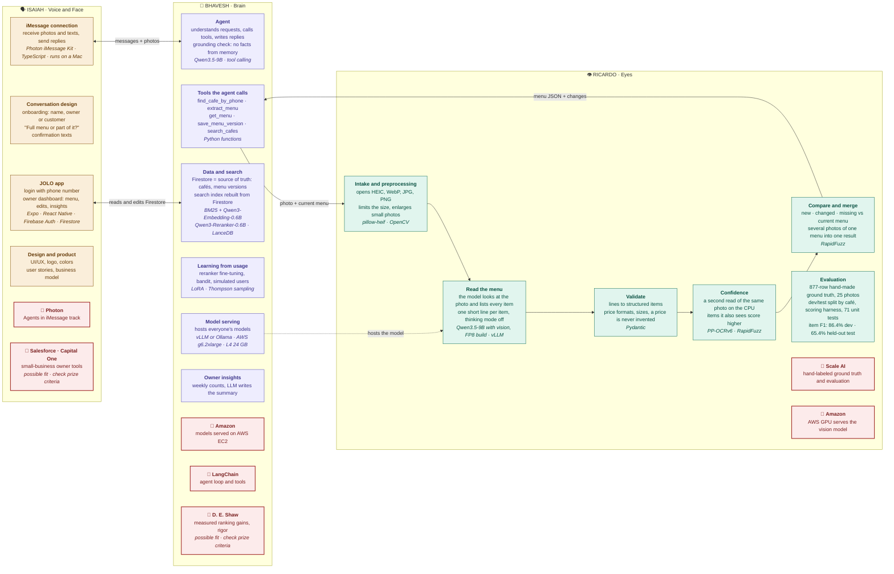

# JOLO responsibilities

I updated my part (the eyes) to show what I actually built and have working.
Bhavesh's and Isaiah's parts are the same as in our original plan.

## What changed in my part

| Original box | Now | Why |
| --- | --- | --- |
| Intake and preprocessing: HEIC, rotation, blur, perspective, contrast | Opens the photo, limits its size, enlarges small photos | Enlarging is the step that helped. I wrote the perspective fix, contrast boost and blur score too, but they're switched off: they didn't help on my dev photos, and I never set a blur threshold. |
| Find the menu (SAM 3) | Removed | I never ran it. My photos are tightly framed, so there was nothing to crop. |
| Read the menu (GLM-OCR, compared with PaddleOCR-VL-1.6, PP-OCRv6, Qwen3.5-9B) | Qwen3.5-9B reads the photo directly | I tried GLM-OCR first and it scored 61.6% item F1 on dev, against 86.4% for Qwen on the photo. I never ran PaddleOCR-VL. PP-OCRv6 moved to the confidence step. |
| Validate and compare | Split into Validate, Confidence, and Compare and merge | Each is its own module. Merging several photos of one menu is new. |
| Evaluation: 877-row verified ground truth, comparison table | Same data, with measured results | I made the ground truth by hand and haven't fully double-checked it. I measured two setups on dev, and ran only the one I chose on the held-out test photos. |
| Vision training (synthetic menus, Qwen3.5-4B LoRA) | Removed | I didn't get to it. |

## Notes on the arrows

- **The agent calls two functions:** `extract_menu(photo, current_menu)` for one photo and `merge_results(results, current_menu)` for several photos of one menu. Only `extract_menu` is in Bhavesh's tool list above; I added `merge_results` later.
- **"Hosts the model":** right now the Qwen3.5-9B server runs on my AWS VM, and I start it with `scripts/vm/serve_qwen_vision.sh`. Bhavesh, we still need to agree whether it moves under your model serving. Your agent model is also Qwen3.5-9B, so one server may be able to do both jobs; I haven't tested that.
- **I took out the arrow from vision training to the database**, because there is no training yet. Owner corrections are still worth storing for later.

See [`integration-guide.md`](integration-guide.md) for how to connect, [`menu-update-flow.md`](menu-update-flow.md) for the step-by-step flow, and the [README](../README.md) for the full reference.
